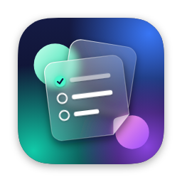
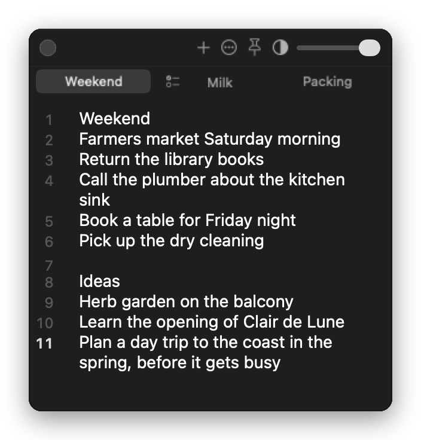
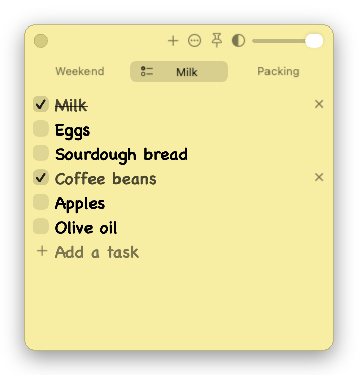

<h1 align="center">YANA</h1>

Yet Another Notes App: quick notes and to-do lists that live in your Mac's menu bar.

<a href="https://github.com/jfreema/Yet-Another-Notes-App/raw/main/downloads/YANA.zip"><b>Download YANA</b></a>

Version 1.7.1 · macOS 14 or later · Apple silicon or Intel

  
  &nbsp;&nbsp;
  

- **One click away.** Click the menu bar icon to show your note and again to put it away. Everything saves as you type.
- **Notes and to-do lists.** Keep up to four tabs. Check tasks off and clear them away with **Clear Checked**, press Return in one to add a task below it, drag them into order, or turn a note into a list with ⇧⌘L.
- **Sticky note mode.** Post-it yellow with hand-lettered text, from the **…** menu.
- **Stays where you want it.** Pin it above other windows, and slide its transparency to see through it.
- **Plain text files.** Open and save .txt files with ⌘O and ⌘S. A to-do list saves with a `[ ]` or `[x]` in front of each task, and a file like that opens as a list again. Notes and lists have line numbers.
- **Sync lists with your other Macs.** Pick which lists sync and which of your devices each one goes to, through iCloud Drive or any folder your Macs share. See [Syncing lists](#syncing-lists).
- **Updates itself.** **Check for Updates…** installs the latest version in place, and your notes stay put.

## Install

Unzip **YANA.zip**, drag **YANA.app** into **Applications** and open it. Then right-click its menu bar icon and turn on **Open at Login**.

## Syncing lists

A to-do list can sync with YANA on your other Macs. Each list syncs on its own, through a folder all those Macs can reach, and only to the Macs you tick.

1. On the Mac with the list, right-click its tab (or open the **…** menu) and choose **Sync This List…**.
2. Pick a folder. **YANA Sync (iCloud Drive)** is made for you the first time. To sync with a Mac signed in to a different Apple ID, such as a work Mac, make a folder in iCloud Drive, share it with that Apple ID with edit access (in Finder: right-click it, **Share** › **Share Folder**), and pick it here.
3. Tick the Macs the list should go to, and click **Sync**. A Mac shows up to tick once YANA on it has added the folder: on that Mac, choose **Add Sync Folder…** from YANA's menu and pick the folder (a shared folder appears in its iCloud Drive once the invite is accepted).

The list appears on the other Macs within seconds, as its own tab, with a sync mark. Changes on any of them merge task by task: two Macs can change different tasks at once, and when both change the same task, the later change wins. Lists sent from other Macs get a tab even when you already have four.

**Sync Settings for This List…** changes which Macs get it, or stops it syncing (each Mac keeps its own copy). Unticking a Mac takes the list off that Mac. Deleting a synced list's tab removes it from this Mac only. Under each Mac it says when YANA last heard from it, which is the last time that Mac had a change to pass on.

Only to-do lists sync, not notes. Any folder that syncs between your Macs works, such as Dropbox or Syncthing. Saving a list as a text file in that folder doesn't sync it: that's a separate copy, and **Sync This List…** is what keeps the Macs together. YANA writes small files in it: one per Mac in `devices`, and one per Mac per list in `lists`.

Developers: see [AGENTS.md](AGENTS.md) for building and [docs/signing.md](docs/signing.md) for releases.
