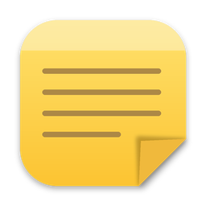
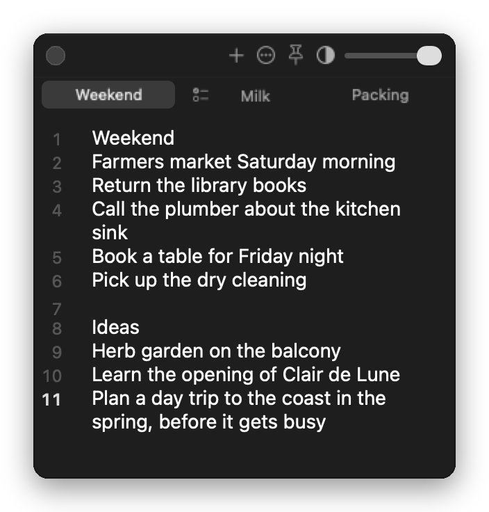
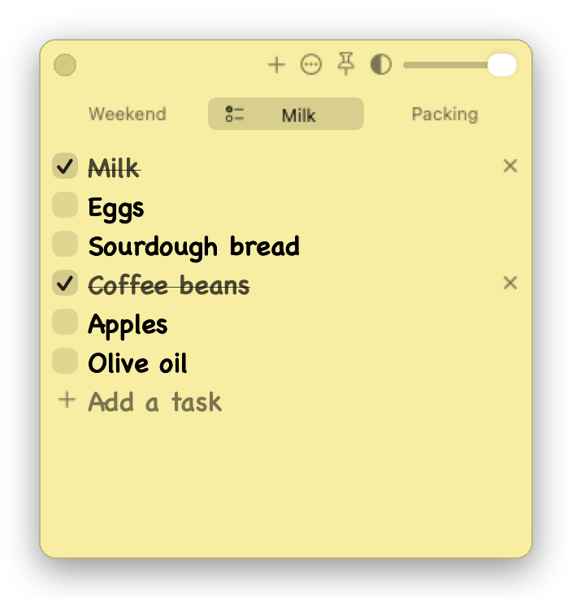

<h1 align="center">YANA</h1>

Yet Another Notes App: quick notes and to-do lists that live in your Mac's menu bar.

<a href="https://github.com/jfreema/Yet-Another-Notes-App/raw/main/downloads/YANA.zip"><b>Download YANA</b></a>

Version 1.5.0 · macOS 14 or later · Apple silicon or Intel

  
  &nbsp;&nbsp;
  

- **One click away.** Click the menu bar icon to show your note and again to put it away. Everything saves as you type.
- **Notes and to-do lists.** Keep up to four tabs. Check tasks off, press Return in one to add a task below it, drag them into order, or turn a note into a list with ⇧⌘L.
- **Sticky note mode.** Post-it yellow with hand-lettered text, from the **…** menu.
- **Stays where you want it.** Pin it above other windows, and slide its transparency to see through it.
- **Plain text files.** Open and save .txt files with ⌘O and ⌘S. Notes and lists have line numbers.
- **Updates itself.** **Check for Updates…** installs the latest version in place, and your notes stay put.

## Install

Unzip **YANA.zip**, drag **YANA.app** into **Applications** and open it. Then right-click its menu bar icon and turn on **Open at Login**.

Developers: see [AGENTS.md](AGENTS.md) for building and [docs/signing.md](docs/signing.md) for releases.
